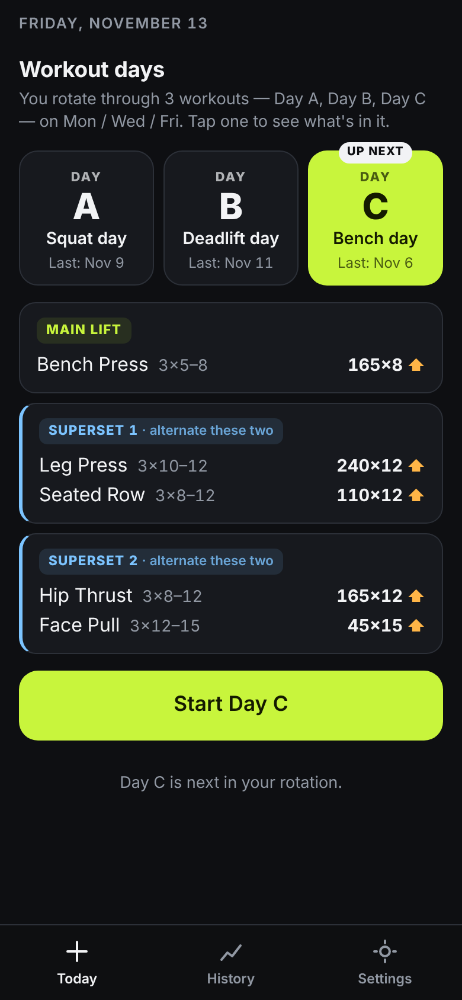
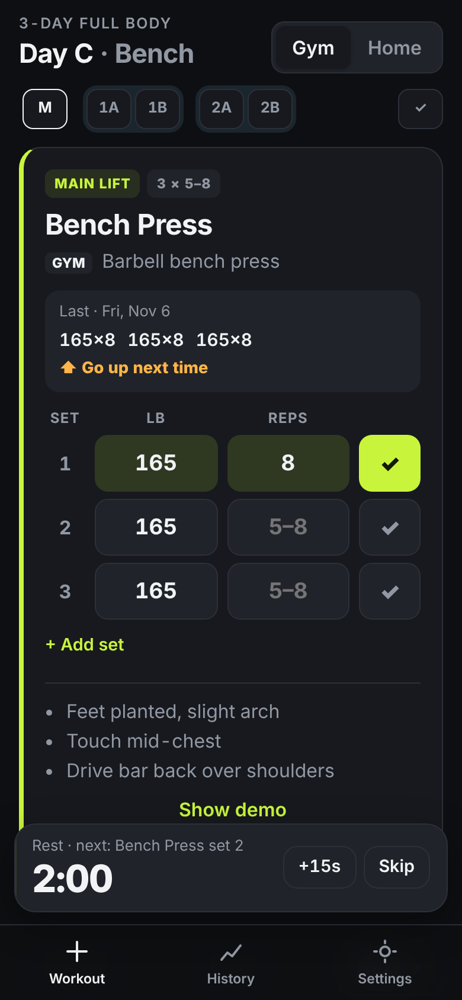
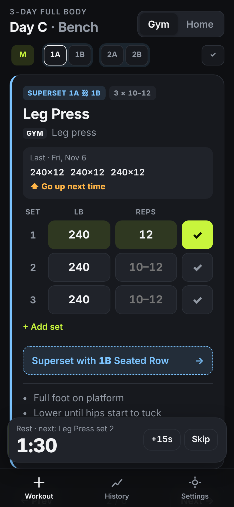
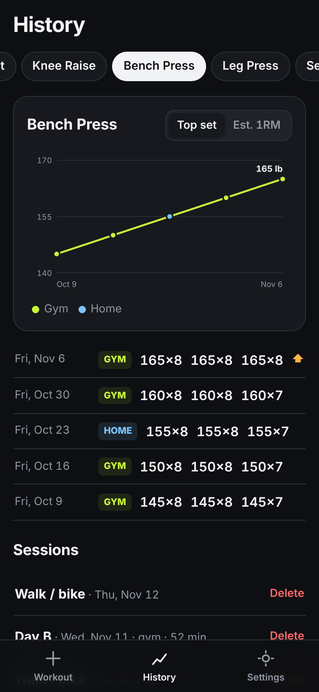
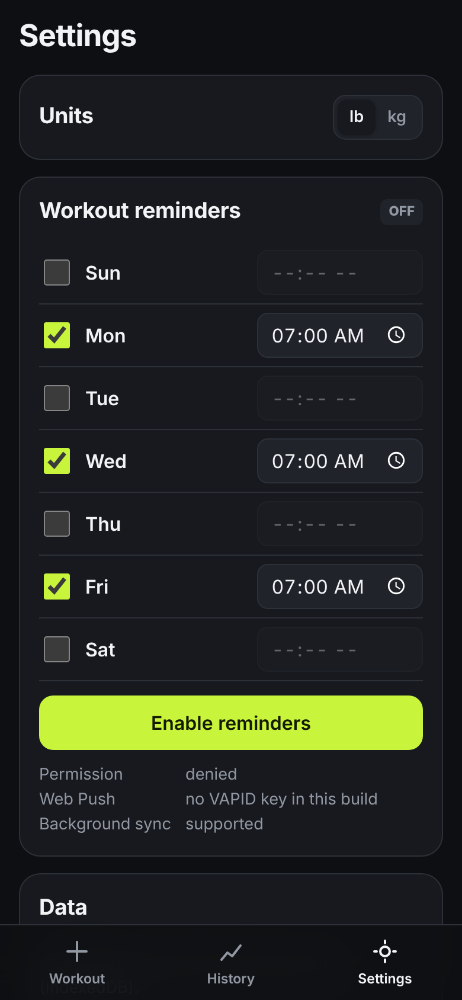

# Workout Tracker

A mobile-first, offline-capable workout tracker for a 3-day full-body program. It's an installable PWA that you can add to your iPhone home screen. There's no backend: everything is stored on your device in IndexedDB.

**Live demo:** https://nkellerdb.github.io/personal/

<p>
  
  
  
  
  
</p>

## The program

- **Days A, B and C** rotate on **Mon / Wed / Fri**. Each day is one main lift followed by two supersets.
- **Tue / Thu / weekend** are walk or bike days.
- The rotation follows what you've actually done, not the calendar. If you miss Wednesday, Friday is still Day B.

The whole program lives in **[`src/program.json`](src/program.json)**. Edit it, commit, and the site redeploys.

```jsonc
{
  "rotation": ["A", "B", "C"],
  "liftDays": ["mon", "wed", "fri"],
  "rest": { "main": 120, "superset": 90 },        // seconds
  "days": [{
    "id": "A", "name": "Day A", "focus": "Squat",
    "blocks": [
      { "type": "main", "exercises": [ { ... } ] },
      { "type": "superset", "exercises": [ { ... }, { ... } ] }
    ]
  }]
}
```

Each exercise looks like this:

| field | example |
| --- | --- |
| `id` | `"squat"`: unique, and used to link history and demo files |
| `name` | `"Squat"` |
| `sets` | `3` |
| `repRange` | `[5, 8]` |
| `gym` | `"Barbell back squat"` |
| `home` | `"Goblet squat (heavy dumbbell or kettlebell)"` |
| `cues` | `["Brace before you descend", "..."]` |
| `demo` | `{ "file": "squat.mp4", "youtube": "https://..." }` (both optional) |

> If you rename an exercise, keep its `id` so its history stays attached.

## Features

- **Today view** opens to the next scheduled day. On off days it shows the walk/bike card and what's next.
- **One exercise card at a time.** Swipe or tap the dots to move between them. Supersets appear as linked pairs (1A ⛓ 1B).
- **Set logging** with weight and reps. Each card shows your numbers from the last session, and weights are prefilled from it. Tapping ✓ on an empty row fills in last session's numbers.
- **"Go up next time"** appears when every set hit the top of the rep range.
- **Rest timer:** 2 min after main-lift sets and 90 s after each superset round. Finishing a superset set takes you straight to its partner, and the rest starts once both are done. When the rest ends you get vibration (Android), a beep (all devices) and a notification if the app is in the background.
- **Gym / Home toggle** per session. Last-session numbers use the same mode when possible.
- **History:** a progress chart per lift (top set or estimated 1RM), a per-lift log and a session list.
- **Reminders** on the days and times you choose (see below).
- **Demo media:** local GIF/MP4 files, falling back to a YouTube link.
- **JSON export/import** under Settings, for backups.
- Works fully **offline** after the first load.

## Setup

```bash
npm install
npm run dev        # http://localhost:5173
npm run build      # type-check + production build into dist/
npm run preview    # serve the production build (service worker active)
```

Requires Node 20+.

### Deploy to GitHub Pages

1. Push to `main`.
2. In the repo, go to **Settings → Pages → Build and deployment → Source** and choose **GitHub Actions** (one-time).
3. [`.github/workflows/deploy.yml`](.github/workflows/deploy.yml) builds with `BASE_PATH=/<repo-name>/` and publishes the site to `https://<user>.github.io/<repo-name>/`.

On GitHub Free, Pages needs a **public** repository.

### Install on iPhone

Open the site in Safari, tap **Share → Add to Home Screen**, then launch it from the home screen icon.

## Exercise demos

Put short GIF / MP4 / WebM clips in [`public/demos/`](public/demos). A card looks for them in this order:

1. the file named in `demo.file`
2. `<exercise-id>.mp4`, `.webm` or `.gif` (e.g. `public/demos/squat.mp4`)
3. the exercise's `demo.youtube` link (the default program links to YouTube searches)

Clips are cached for offline use the first time they're shown. Keep them small: a 3–6 s loop under ~2 MB.

## Reminders (Web Push)

Push notifications need something to send them on a schedule. Instead of running a server, this repo uses a **scheduled GitHub Action** ([`reminders.yml`](.github/workflows/reminders.yml)). It runs every 15 minutes and pushes to your device with your VAPID keys.

One-time setup:

1. Generate keys:
   ```bash
   npm run vapid
   ```
2. In the repo, go to **Settings → Secrets and variables → Actions** and add:
   - **Variable** `VAPID_PUBLIC_KEY`: the public key (it's also baked into the app build)
   - **Secret** `VAPID_PRIVATE_KEY`: the private key
   - **Variable** `VAPID_SUBJECT` (optional): `mailto:you@example.com`
3. Re-run the **Deploy** workflow so the app picks up the public key.
4. On your phone, open the installed app and go to **Settings → Workout reminders**. Pick days and times, tap **Enable reminders**, then **Copy push config**.
5. Save that JSON as the **secret** `PUSH_CONFIG`, then add the **variable** `REMINDERS_ENABLED` = `true`.
6. Optional: run the **Workout reminders** workflow manually with *force* ticked to get a test push right away.

If you change reminder times in the app, copy the push config again and update the secret.

Things to know:

- **iPhone** needs iOS 16.4+, and the app must be opened from the home screen icon. Safari tabs can't receive push.
- GitHub's scheduled runs can be a few minutes late, so reminders arrive within about 15 minutes of the set time. Times on the quarter hour (7:00, 7:15, …) line up best.
- `PUSH_CONFIG` can also be a JSON **array** if you want reminders on several devices.
- **Local fallback:** without push configured, Chromium browsers (Android/desktop installed PWA) use Periodic Background Sync to show reminders from the service worker. Timing is approximate (roughly hourly), and a reminder is skipped if you've already logged a session that day.

## Project layout

```
src/
  program.json          ← the program (edit me)
  logic.ts              rotation, last-session lookup, go-up rule
  db.ts                 IndexedDB (sessions + settings), shared with the SW
  sw.ts                 service worker: offline cache, push, periodic sync
  reminders.ts          permission, push subscription, push config export
  timer.tsx             rest timer state, vibration and beep
  components/           Today, Workout, ExerciseCard, History, LineChart, Settings
scripts/
  send-reminders.mjs    run by the reminders workflow
  make-icons.mjs        regenerates PNG icons from public/favicon.svg
public/demos/           your GIF/MP4 demo clips
```

## Data & privacy

All workout data stays in your browser's IndexedDB on your device. Clearing site data, or deleting the home-screen app on iOS, erases it, so use **Settings → Export JSON** for backups. The only data that leaves the device is the push subscription you choose to store as a GitHub secret.
